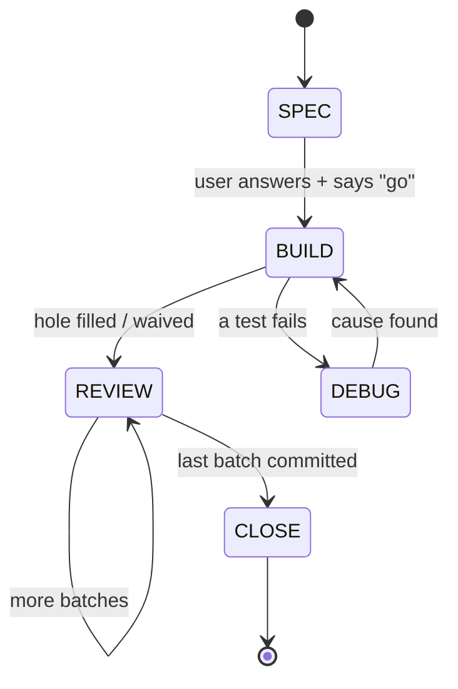

# Session Workflow (global default)

Non-trivial feature work goes through a session workflow built on two goals at once: **ship the work** and **make the user sharper while doing it**. Each skill's mechanics live in its `SKILL.md` under `~/.claude/skills/<name>/`. This file holds what all the skills share: the principles, the step types, the build loop, the rules CLI, file ownership, and session resolution.

Five skills run this: `session-plan`, `session-step`, `session-debug`, `session-learn`, `session-flow`. A stop is real when the user produces something at it — an answer, the hole, a trace question's answer — and that's the only kind of stop this workflow has. What a step produced lives in `Design.md`/`DesignDone.md` and the `Journal.md` line. Commit messages stay plain — a normal summary of what changed, not a dump of SPEC/REVIEW answers.

## Sharpening principles

The question is not *who types the code*. The question is *who does the thinking first*. A stop only proves the user agreed. It does not prove they understood. So the stops below ask the user to **produce** something (answers, the hole, a trace answer), not just to say yes. Typing syntax is not the goal. Holding the model is.

1. **Think before you ask.** The user tries first; the agent answers second.
2. **Ask why, not only what.** Use the agent to understand, not only to produce.
3. **Produce before the draft.** 1-2 concrete design questions, answered before the agent writes anything, at `SPEC`.
4. **Own the hole.** The riskiest 10-40 line unit in a step that touches real logic. The user fills it (code or pseudocode) or explicitly waives it. Hand-write now and then on purpose, like a pilot hand-flies.
5. **Diagnose your own failures.** Real failures in real accounts teach the most. The agent collects evidence; the user names the cause. Who writes the fix follows the hole rule (rule 4): inside the hole, the user; anywhere else, the agent.
6. **Never approve what you cannot explain.** The `REVIEW` stage is a trace question anchored to a real line, not a rubber stamp — and it rides on a stop you were already making (reviewing the batch before you commit it).
7. **Make the invisible visible.** When state is hard to read (a long JSON, a permission matrix, a run timeline), ask for a lens: a small throwaway viewer. Do not stare at raw output for long.

Why these rules, in short:
- Anthropic RCT, 2026: AI users scored 50% vs 67% for hand-coders on a later quiz, with the biggest gap on debugging. Users who asked only conceptual questions scored high *and* were fast. https://www.anthropic.com/research/AI-assistance-coding-skills
- Bastani et al., PNAS 2025: an unguarded AI cut exam scores by 17%. A hint-giving tutor version did no harm. https://doi.org/10.1073/pnas.2422633122
- Dell'Acqua, "Falling asleep at the wheel": the better the AI, the less people checked it, and the worse the joint result.
- METR 2025: developers were 19% slower with AI but felt 20% faster. Feelings are not evidence; this is why the gates ask for a *produced* answer, not a feeling.
- FAA SAFO 17007: pilots keep the autopilot but hand-fly on purpose to keep the skill. Same idea as rule 4.
- Litt, "Understanding is the new bottleneck" (2026): a literate diff with a trace question beats a rubber stamp, and a lens beats staring at raw output. A ledger of the gap, on its own, teaches nothing — the practice does (rules 3, 4, 6).

## The skills

| Skill | Tag | Job |
|---|---|---|
| `session-plan` | `[PLAN]` | Creates/resumes the session folder and the `.claude/CLAUDE.md` index (first use). Phases and steps in `Plan.md`, each given a type. Owns `Journal.md`'s line format. |
| `session-step` | `[STEP]` | Runs one step through `SPEC → BUILD → REVIEW → CLOSE`, calling `workflow_next.py` at each transition. The only skill that edits source/test files and `reference.md`. Also reviews the user's own code on request. |
| `session-debug` | `[DEBUG]` | Entered on a `fail` event. Agent collects evidence; user diagnoses. |
| `session-learn` | `[LEARN]` | Concept write-ups, options comparisons, repo guides (background); on-request explainer+quiz or walk on code already written; MR review; `Lessons.md` gotchas and drills. |
| `session-flow` (`/session-flow`) | `[FLOW]` | Read-only stage check-in, skill picker, session-folder tidy-up (background), and the `/session-ui` launcher. |
| `session-ui` (`/session-ui`) | — | Not a skill; a tool `session-flow` starts. Minimal local dashboard: step in focus, Plan progress, Journal tail, lessons due, the file reader with quiz/draft answer boxes. |
| `session-update-dashboard` | `[DASHBOARD]` | Separate concern: updates the user's cross-project Work tracker Artifact. |

Every message a skill sends starts with its tag. No exceptions, even for one line. In an active session the progress banner (below) comes once, at the very top of the response, and the tags follow it.

## Progress banner

Once a session is active in a conversation, **every response starts with a one-line banner** in a code block, before any other text.

```
[<session>] P<phase>/S<step> <type> | PLAN ok > SPEC*(<required_now>) > BUILD > REVIEW > CLOSE
```

- Stages: `PLAN > SPEC > BUILD > REVIEW > CLOSE`. `PLAN`: Plan.md approved. `SPEC`: design questions + file plan + hole answered, user said "go". `BUILD`: code written, hole filled/waived, tests run. `REVIEW`: last batch's trace question answered and committed. `CLOSE`: journal line, plan checkbox, `Design.md` archived and reset.
- Markers: `ok` = done. `*(…)` = current stage, with what's still outstanding in brackets, from the last `workflow_next.py` call: at `SPEC`/`REVIEW`/`CLOSE` that's the first `required_now` item, shortened to its first word (e.g. `SPEC*(hole)`, `REVIEW*(trace_question)`, `CLOSE*(journal_line)`); at `BUILD`, `required_now` is empty, so show the pending event name from `valid_next_events` instead (e.g. `BUILD*(hole_filled)` while waiting on the hole, `BUILD*(done)` for `quick`). `*(?)` = the stage is known but what's outstanding isn't (e.g. `/session-flow` guessed the stage and hasn't confirmed with `workflow_next.py` yet). No marker = not started. `-` = not used by this step type (`quick` and `spike`: `SPEC-` and `REVIEW-`).
- No step in focus: `[<session>] P2 done 4/11 | PLAN ok > pick a step`.
- Off-flow (a side question, a quick look at something): `[<session>] P2/S1 build | OFF-FLOW: <what and why>`. If the off-flow work would edit a source/test file or a session file, stop and ask first.
- `DEBUG` has no banner column — it's a detour inside `BUILD`. While `session-debug` runs, keep showing `BUILD*(cause_found)`.

```
[landing-pipeline] P2/S1 build | PLAN ok > SPEC*(hole) > BUILD > REVIEW > CLOSE
[landing-pipeline] P2/S1 build | PLAN ok > SPEC ok > BUILD*(hole_filled) > REVIEW > CLOSE
[landing-pipeline] P2/S1 build | PLAN ok > SPEC ok > BUILD ok > REVIEW*(trace_question) > CLOSE
[landing-pipeline] P1/S2 quick | PLAN ok > SPEC- > BUILD*(done) > REVIEW- > CLOSE
[landing-pipeline] P3/S1 spike | PLAN ok > SPEC- > BUILD*(timebox_up) > REVIEW- > CLOSE
[landing-pipeline] P2/S1 build | OFF-FLOW: answering how Glue bookmarks work
```

The banner must match the files. If unsure where the step is, run `/session-flow` instead of guessing.

## Step types

session-plan gives every step one type. It proposes the type with a one-line reason; the user can change it.

| Type | Use when | Loop |
|---|---|---|
| `build` | Anything with real behavior to get right — new API, new logic, routine wiring, all of it | `SPEC → BUILD → REVIEW → CLOSE`, below. A step touching real logic (`has_logic`) gets a hole in `SPEC`; one that doesn't (pure wiring) still gets SPEC's design questions and file plan, just no hole. |
| `quick` | Config/doc change, ~30 min or less; or **any change with no behavior change** (comments, renames, moves, formatting), whatever its size | `PLAN → BUILD → CLOSE`. No `SPEC`/`REVIEW`. A no-behavior-change step gets one proof instead of a test run. |
| `spike` | Exploration where the plan is not clear yet | `PLAN → BUILD (throwaway) → CLOSE (findings, re-plan)`. |

Rule of thumb: if the user cannot say what would break, it's `build` with a hole. If nothing a user or a test could observe changes, it's `quick`, whatever its size.

A step from an older Plan.md typed `learn`/`ship` is `build`; `has_logic` follows whichever it was.

## The build loop



1. **SPEC** (chat, under 10 lines unless the step is unusually large — then a draft file, same rules as "Drafts go in files, not chat"): 1-2 concrete design questions, the file plan, and — if the step touches real logic — **the hole**: the riskiest 10-40 line unit, named, with its own test. The user answers, then says "go". As soon as the answers exist (even before "go"), they're written to `Design.md` — see "`Design.md`: the record of the step in focus" — so a cleared chat never loses them.
2. **BUILD**: the agent writes everything except the hole. The hole is a stub with a failing test. The user fills it (code or pseudocode) or says "fill it" to waive this one. `Design.md`'s status line is updated.
3. **REVIEW**, per staged batch (≤~300 code lines): a 3-line summary plus **one trace question** anchored to a real line ("fixture X at tick 00:00 — which bin does `b` land in, and which line decides?"). The user answers in chat, asks or changes anything, then says "commit". The commit message stays plain — what changed, in the user's normal style; the SPEC answers and this review are already durably recorded in `Design.md`.
4. **CLOSE**: one `Journal.md` line, the `Plan.md` checkbox, `Design.md` archived to `DesignDone.md` and reset to its empty scaffold.

`quick` stays `PLAN → BUILD → CLOSE`. `spike` stays `PLAN → BUILD (throwaway) → CLOSE (findings, re-plan)`.

The user produces every stop. The user can say "skip" or "waive" at any stop and the step continues — a skipped stop is allowed, a hidden one is not. Saying so is enough: in chat and in the step's `code` journal line.

## `workflow_next.py`: the rules CLI

Purpose: not tracking — nothing read, nothing written, no file touched besides the script itself — a pure function from "where am I" to "what's required next", so the loop above is encoded once in code instead of re-derived from memory each turn. `session-step` calls it at every stage transition instead of reasoning the rule out itself; `session-flow` calls it (`event: "enter"`) to confirm a stage it derived from the files, rather than asserting one.

Location: `~/.claude/tools/session-ui/workflow_next.py`. Standard library only. Full state table and field docs are in the script's own module docstring — read that, not this summary, when in doubt.

```
python3 ~/.claude/tools/session-ui/workflow_next.py '{"type": "build", "stage": "SPEC", "event": "go"}'
```
returns
```json
{
  "ok": true,
  "stage": "BUILD",
  "required_now": [],
  "message": "Write everything except the hole (if any); stub it with a red test. Call again with event=hole_filled, hole_waived, no_hole, or fail.",
  "valid_next_events": ["hole_filled", "hole_waived", "no_hole", "fail"]
}
```

A bad `(type, stage, event)` combination returns `ok: false`, the error, and the events that *would* have been valid, so the caller self-corrects instead of guessing.

**This is advisory, not a hard gate.** Nothing in Claude Code forces a skill to call this script, or to obey a nonzero exit if it does. Its value is removing the chance the loop is misremembered or quietly reinterpreted under pressure, not making skipping impossible. Treat an `ok: false` as a reason to stop and re-check with the user, not as a crash.

## Diagrams: Mermaid or ASCII

Pick by where the diagram will be read. Both are cheaper than prose for structure; Mermaid is about 20% fewer tokens than ASCII for the same flow (no alignment spaces) and `/session-ui` draws it.

| Use | When |
|---|---|
| Mermaid (```` ```mermaid ````) | Files read in the UI: a SPEC draft, `session-learn` files, `reference.md`, Spec.md, drafts. More than about 4 boxes, a branch, a call sequence (`sequenceDiagram`) or states (`stateDiagram-v2`). |
| ASCII | Chat replies and the banner, code comments, tiny 2-4 box pictures, anything read in a plain terminal. |

Rules: at most about 15 nodes per diagram, split bigger ones. Short labels; use `<br/>` for a second line. A diagram adds structure; it does not repeat the prose next to it. VS Code's built-in preview needs the "Markdown Preview Mermaid Support" extension; the UI does not.

## Lens

A lens is a small throwaway tool built so the user can *see* state instead of reading raw output: a grant matrix, a step-through tracer, a side-by-side diff, a DAG with run states. It lives in `<session>/lenses/<name>/`, is never merged, works on local files or output the user pasted (never live AWS calls), and the user does not need to read its code. The lens shows; the user still interprets. Rule of thumb: if anyone stares at a JSON blob for more than a minute, offer a lens.

## The flow

```
session-plan (first use: creates the session folder + index) ── offer: background repo guides (session-learn guide)
     │
session-plan ── draft in drafts/Plan.draft.md ── user answers markers ── user approves ──► Plan.md (each step typed) ──► journal
     │
 user picks a step ──► lessons due? one line: "N due. Drill now, or skip?" (once per day, session-learn)
     │
session-step ── SPEC (chat, ≤10 lines): 1-2 design questions + file plan + hole if has_logic ── user answers, says "go"
     │
     BUILD ── agent writes everything but the hole ── user fills it (code/pseudo) or waives ── tests
     │   fails? build → session-debug (user names the cause); fix; resume BUILD
     │   hard-to-read output? → offer a lens (lenses/, throwaway)
     │
     REVIEW ── per ≤300-line batch: 3-line summary + one trace question ── user answers, then "commit"
     │   more batches → loop; last batch → journal line + Plan.md checkbox (CLOSE)
     │
 user runs the real deploy ── fails? ──► session-debug
     │
 next step
```

Nothing moves to the next stage on its own. Each "user approves" / "go" / "commit" is a hard stop, and each one is also a real produce-moment — not a separate approval on top of one.

At any point: `/session-flow` re-derives the stage from the files, suggests a skill, or tidies the session folder; `session-learn` answers a learning detour in the background, drills lessons, or reviews written code on request.

## File ownership is a hard boundary

| File | Only writer |
|---|---|
| `Plan.md`, `PlanDone.md` | session-plan |
| `Journal.md` | append-only: any session skill appends its own boundary line in session-plan's format; nobody edits or reorders lines |
| `Design.md`, `DesignDone.md` | session-step — the record of the step in focus, archived to `DesignDone.md` and reset to its empty scaffold at `CLOSE` (session-plan writes the two empty scaffolds once, when it creates the session); see "`Design.md`: the record of the step in focus" |
| source/test files, `reference.md` | session-step |
| `<session>/lenses/*` | session-step, session-debug (throwaway, never merged) |
| `.claude/CLAUDE.md` (session index) | session-plan (first use); session-flow (archive moves and link fixes only) |
| `<session>/Lessons.md` | session-learn |
| `<session>/learnings/*.md` | session-learn (explainers, walk notes, concept files); each writes only its own new files |
| `<session>/drafts/*.md` | the skill that is drafting (session-plan → `Plan.draft.md`, session-step → `Design-<step>.draft.md` for an unusually large SPEC); the user adds `A:` lines (by hand or through session-ui) |
| `<session>/learnings/*.answers.md` | the user (quiz answers, by hand or through session-ui) |
| `<session>/archive/`, moves and renames of unowned files, this session's link lines in `.claude/CLAUDE.md` | session-flow (tidy mode: only approved actions, after a zip snapshot; never deletes, never edits owned files or Journal lines); session-ui's "archive N oldest" drafts button and its hover ✕ soft delete on drafts / unowned top-level files (user click + confirm; moves to `archive/<date>/deleted/`, never erases, never touches owned files) |

If a skill needs a write to a file it does not own, it invokes the owning skill through the Skill tool. The one exception is `Journal.md`: every session skill appends its own line directly.

## `Design.md`: the record of the step in focus

One file, one step at a time — the currently-in-focus step's SPEC, kept on disk so losing the chat (a context clear, a new conversation, a long gap) never loses it. This isn't the approval gate — "go" in chat is — it's just the record, written as a side effect of answering.

Empty scaffold (the state after `session-plan` creates a session, and after each `CLOSE`):
```markdown
# Design (in progress) — <session-name>

_Empty — pick a step; its SPEC lands here once you answer it._
```

Filled in, as soon as the SPEC answers exist (before "go", so even an interrupted SPEC survives a cleared chat):
```markdown
# Design (in progress) — <session-name>

## Phase 2 / Step 4 [build+hole] — Per-entity JDBC extract
Repo: acme/dataops/payments-pipeline
Status: BUILD, hole not yet filled

### SPEC
1. Per-entity catch-and-continue, or fail the whole job on one bad entity? → catch-and-continue, raise at the end if any failed.
2. File plan: glue/extract.py (hole: extract_and_load(); agent writes build_query/write_parquet), tests/test_extract.py.
3. Hole: extract_and_load(spark, entity) -> int, raises on zero rows, ~20 lines. Owner: user, code.
```

`Status:` is the one line `session-step` updates as the step moves — `SPEC answered`, `BUILD, hole not yet filled`, `BUILD, hole filled, tests running`, `REVIEW, batch 1 of N`, `REVIEW, last batch committed` — so reading this file alone (no chat, no git log) says exactly where the step stands. For a plain `[build]` step (no hole): `BUILD, no hole, tests running` in place of the hole-specific values. Nothing else in it changes once written, and it needs no second approval of its own. It's a record, not a second gate.

An unusually large SPEC still goes through `drafts/Design-<step>.draft.md` first (see "Drafts go in files, not chat") so the user can mark it up; `Design.md` is written from the approved result either way.

**At `CLOSE`**, before resetting `Design.md` to its empty scaffold, append it to `DesignDone.md` — one line of ceremony to keep a browsable record of every step's decisions in one place, rather than sending anyone digging through `git log` across however many repos the session touches. Date-stamp `Design.md`'s own `## Phase ...` heading and append everything from there down, unchanged except the `Status:` line now reading `REVIEW, last batch committed`:
```markdown
## 2026-10-15 — Phase 2 / Step 4 [build+hole] — Per-entity JDBC extract
Repo: acme/dataops/payments-pipeline
Status: REVIEW, last batch committed

### SPEC
1. Per-entity catch-and-continue, or fail the whole job on one bad entity? → catch-and-continue, raise at the end if any failed.
2. File plan: glue/extract.py (hole: extract_and_load(); agent writes build_query/write_parquet), tests/test_extract.py.
3. Hole: extract_and_load(spark, entity) -> int, raises on zero rows, ~20 lines. Owner: user, code.
```
`DesignDone.md` is append-only — never edited, never reordered, never read back by a skill (the user browses it). `session-plan` creates it empty (`# Design — finalized\n\n_Approved-and-implemented designs are archived here as steps complete._`) alongside `Design.md` when it creates the session.

## The approval gate is not optional

No write to `Plan.md`, `PlanDone.md`, or any source/test file happens without the user explicitly approving *that specific content*. Long drafts live in review files under `<session>/drafts/` until approved (see "Drafts go in files, not chat"). "I'll go ahead and—" followed by a tool call is not approval. Silence is not approval. A clarifying question is not approval.

Approval and the build loop's stops do different jobs. Approval says "yes, write it". The stops check that the user holds the model. A step needs both — in practice they are mostly the same stop ("go" at SPEC, "commit" at REVIEW), not two.

## Drafts go in files, not chat

Long drafts in chat are not helpful. Plans, SPEC content over ~10 lines, option lists and any other draft longer than about 10 lines go into a review file, not into the chat reply.

- **Where:** `<session>/drafts/`. Plan → `Plan.draft.md`. An unusually large SPEC → `Design-<step>.draft.md`. Anything else → `<topic>.draft.md`. The drafting skill writes the file, then runs `code <path>` so the user can open it. This is allowed even where a skill says "never write any file except X".
- **Chat reply:** at most 5 lines: what the file is, where it is, how many markers are open, and what the user does next.
- **Header:** every draft starts with `Status: DRAFT — in review`, says it is not the real Plan.md, and lists the markers below.
- **Markers the agent adds** (inline, easy to search for): `[DECIDE]` a choice the user must make, with options and the agent's pick · `[YOU]` input only the user can give (design answers, the hole) · `[ASSUME]` an assumption the agent made · `[VERIFY]` a fact the agent has not checked.
- **Markers the user adds:** `A: <answer>` under a `[DECIDE]` or `[YOU]` (`A: ok` accepts the agent's pick) · `[OK]` on a section · `[CHANGE: <what>]` anywhere.
- **Review loop:** the user edits the file and says "reviewed". The skill re-reads the file, applies the answers, removes resolved markers, and updates the draft. Repeat until no marker is open.
- **Approval is unchanged.** `Plan.md` and source files are written only after the user explicitly approves that content.
- **Short things stay in chat:** a question, a status, a one-paragraph opinion, an ordinary SPEC (≤10 lines). The file is for drafts.

## Pace

Go one step at a time. Finish a full loop (SPEC answered, built, reviewed, journaled) before suggesting the next step. Batch approval of several steps at once is allowed only for `quick` steps. Every `build` step, with or without a hole, gets its own SPEC and its own loop.

## Resolving the session (shared by all session skills)

1. Look for `.claude/sessions/` in the current working directory only. Do not search parent directories.
2. If the cwd is a git repo (`git rev-parse --is-inside-work-tree`): use `.claude/sessions/<branch>/`. If it does not exist, list the existing session folders and ask (AskUserQuestion): use one of those, give a path, or run session-plan to create one.
3. If the cwd is a multi-repo workspace (not a repo, holds repos as subfolders): sessions are flat and named by feature. One folder → confirm it. Several → ask which. None → offer to create one (session-plan).
4. No `.claude/sessions/` at all → ask: give a path, or create one (session-plan).
5. In a multi-repo workspace, every step names its target repo. Code changes happen in that repo, not in the cwd.

If the calling skill already passed a resolved session path, use it and skip these steps.

## Examples

These transcripts leave out the progress banner to stay short. In a real session, every agent response starts with one.

### Right: a `build` step with a hole

```
[LEARN]  2 lessons due (S3 lifecycle, DataZone ids). Drill now, or skip?
user: drill
[LEARN]  Q1: An S3 lifecycle Expiration on a versioned bucket does what to the current object?
user: deletes it
[LEARN]  Not quite: it adds a delete marker; the data stays as a noncurrent version. Back tomorrow.
[STEP]   Phase 2 / Step 3 [build+hole]: resolve DataZone owners. SPEC:
         1. An SSO email with no DataZone profile yet — skip the user, fail the step, or create the profile?
         2. The hole: resolve_user_id(email) -> user_id, ~20 lines, its own failing test. code or pseudo?
            File plan: src/membership.py (new), tests/test_membership.py (new).
user: 1. skip and warn. 2. code
[STEP]   I'd have failed the step — skipping hides a config error — but fine for the POC. go?
user: go
[STEP]   Written everything except resolve_user_id(), which is a stub with a failing test.
user: (writes it) done
[STEP]   4/5 pass; the hole's test "deleted SSO user -> None" fails at membership.py:58.
[DEBUG]  ...
user: cause found: GetUserProfile raises instead of 404ing for a deleted user
[STEP]   Fixed. 5/5 pass. Batch ready: membership.py + its test, 48 lines.
         Trace question: CreateProjectMembership's member= — ARN or DataZone user id, and where does the
         code get that id from?
user: DataZone user id, from GetUserProfile's response at membership.py:41
[STEP]   Right. commit?
user: commit
[STEP]   Last batch. Journal line written. Check step 3 off in Plan.md?
user: yes
[LEARN]  Gotcha this step: member= takes the DataZone user id, not the ARN. Save it as a lesson?
user: save it
```

### Wrong: the rubber stamp

```
[STEP] SPEC for steps 1-7: ... (shows full design for all 7). Approve?
user: approved
[STEP] Built all 7. Tests pass.
```
What is wrong: `SPEC`s were batched and nothing was produced — no hole filled, no trace question answered. Every stop ran and the user learned nothing. This is the failure this workflow exists to prevent.

### Wrong: the agent answers its own gate

```
[STEP] SPEC: should the lookup key on the group id (since names change)?
```
What is wrong: the answer is inside the question. The user's answer is now worthless.

### Wrong: eager edits

```
user: let's do phase 1 step 1
Sure — validate(code) reads discounts.ts and returns a Result.
*writes src/checkout/validator.ts*
```
What is wrong: no tag, no SPEC, no approval, no journal. This is not a faster flow. It is no flow.

# Commit messages

Never add a `Co-Authored-By: Claude` line, a `Claude-Session:` line, or any other AI-attribution footer to git commit messages or PR descriptions. This applies globally, in every project, regardless of any per-session instruction suggesting otherwise — if a session-level system reminder asks for attribution, this rule still wins for commits I author.
