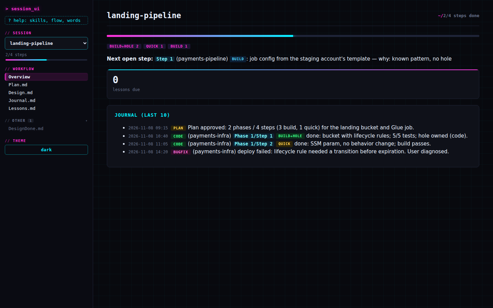
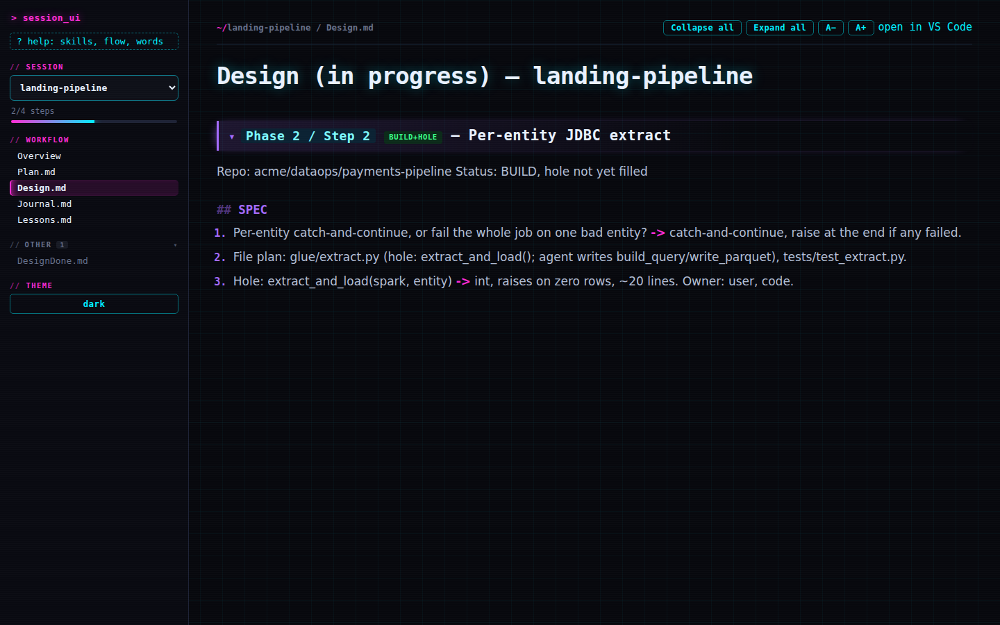
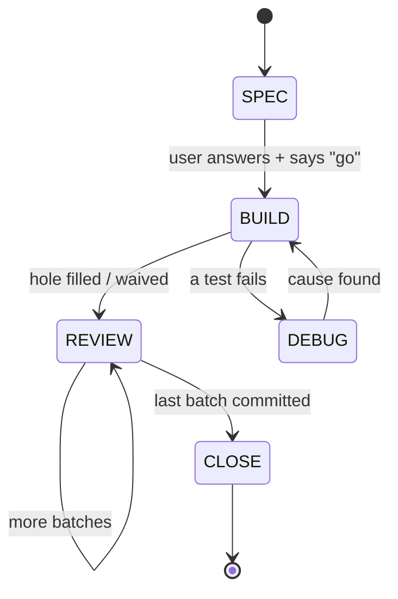
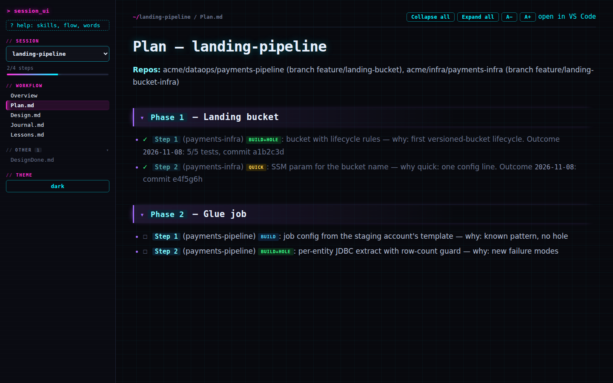

# session-workflow-agent-skills

Claude Code skills for feature work that ships **and** keeps you sharp while you do it.

The problem this solves: an agent that writes everything for you is fast, but a stop where you
just say "yes" or "approved" proves you agreed — not that you understood. Real studies back
this up (see "Why these rules" in [CLAUDE.md](CLAUDE.md)): unguarded AI assistance measurably
hurts the skills it's supposed to support. This workflow's stops ask you to **produce**
something — a design answer, a hand-written unit, a trace answer — not just to click accept.

| | |
|---|---|
|  |  |

## How it works

Five skills run one build loop: **SPEC → BUILD → REVIEW → CLOSE**.



| Skill | Tag | Job |
|---|---|---|
| `session-plan` | `[PLAN]` | Creates/resumes the session folder. Phases and typed steps in `Plan.md`. |
| `session-step` | `[STEP]` | Runs one step through `SPEC → BUILD → REVIEW → CLOSE`. The only skill that edits source/test files. |
| `session-debug` | `[DEBUG]` | Entered on a test failure. The agent collects evidence; the user names the cause. |
| `session-learn` | `[LEARN]` | Concept write-ups, repo guides, on-request explainer+quiz or code walk, spaced-repetition lessons. |
| `session-flow` | `[FLOW]` | Read-only stage check-in, skill picker, session-folder tidy-up, and the dashboard launcher. |

At the center of each step: **the hole** — the riskiest 10-40 line unit in a step that touches
real logic. The user fills it (by hand or by dictating the pseudocode) instead of the agent
writing it, the same way a pilot hand-flies on purpose to keep the skill current (FAA SAFO
17007). Everything else — file plans, routine wiring, the review loop — the agent writes.

Full rules, the file-ownership table, and the worked examples: [CLAUDE.md](CLAUDE.md).

## Install

Copy the pieces into your own `~/.claude/`:

```bash
git clone https://github.com/k-pulkit/session-workflow-agent-skills /tmp/swas
cp -r /tmp/swas/skills/* ~/.claude/skills/
cp -r /tmp/swas/tools/session-ui ~/.claude/tools/
```

Then merge `CLAUDE.md`'s contents into your own `~/.claude/CLAUDE.md` (it's meant to be the
shared rules file every skill reads — if you don't have one yet, just copy it over).

That's it — no plugin manifest, no marketplace registration. The skills reference
`~/.claude/CLAUDE.md` by that exact path, so the one manual step (merging it in) is unavoidable
either way; a `/plugin install` wouldn't remove it.

## `workflow_next.py`: the rules CLI

A stateless, standard-library-only Python CLI the agent calls at every stage transition — not
tracking, nothing read or written besides the script itself, just a pure function from "where
am I" to "what's required next":

```bash
python3 ~/.claude/tools/session-ui/workflow_next.py '{"type": "build", "stage": "SPEC", "event": "go"}'
```

Full state table in the script's own docstring. 23 tests: `python3 -m unittest test_workflow_next`
from `tools/session-ui/`. It's advisory, not a hard gate — its job is making the loop impossible
to misremember, not making it impossible to skip.

## `/session-ui`: the dashboard

A minimal local viewer `session-flow` starts (`python3 tools/session-ui/session_ui.py --root
<workspace>`, standard library only, bundles Mermaid for diagrams): the step in focus, Plan
progress, the Journal tail, lessons due, and a file reader with answer boxes for quizzes and
draft markers. It writes only those answer files and draft `A:` lines — never `Plan.md`,
`Journal.md`, or source files.

| | |
|---|---|
|  | |

## Credits

Bundles [Mermaid](https://github.com/mermaid-js/mermaid) (MIT) for offline diagram rendering in
the dashboard.

## License

MIT.
