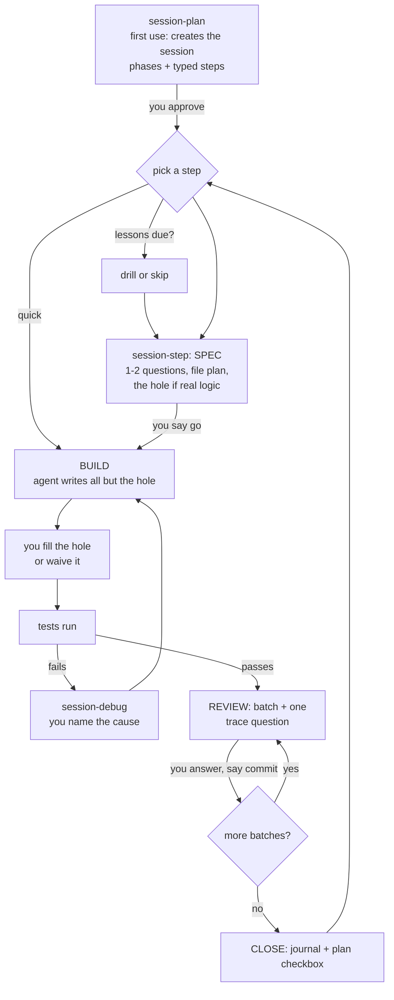

# How the session workflow works

Two goals at once: **ship the work**, and **keep it in your head**. Every stop asks you to *produce* something (an answer, the hole, a trace answer), not just to say yes. No separate tracking — no event log, no counters. Full rules: `~/.claude/CLAUDE.md`.

## The loop



Nothing moves on its own. Each "go" / "commit" is a hard stop, and it is also the produce-moment — not a separate approval on top of one.

## Step types

| Type | Use when | You do |
|---|---|---|
| `build` | Anything with real behavior — new logic or routine wiring | SPEC answers; a hole (own it, code or pseudo) when the step touches real logic; a trace question per REVIEW batch |
| `quick` | Config/docs, ~30 min; or no behavior change at any size | Just the build; one proof or a test run at close |
| `spike` | The plan is not clear yet | Say what would answer the question before each experiment; findings, then re-plan |

Rule of thumb: if you can't say what would break, give it a hole. If nothing observable changes, it's `quick`, whatever its size.

## `workflow_next.py`

A stateless rules CLI the agent calls at each transition — `python3 ~/.claude/tools/session-ui/workflow_next.py '{"type":"build","stage":"SPEC","event":"go"}'` — so the loop above lives in code, not in memory of a long file. It reads and writes nothing; it's advisory, not a hard gate. Full state table: the script's own docstring.

## Reading the banner

```text
[my-feature] P2/S1 build | PLAN ok > SPEC*(hole) > BUILD > REVIEW > CLOSE
```

| Part | Meaning |
|---|---|
| `P2/S1 build` | Phase 2, step 1, type `build` |
| `ok` | stage done |
| `*(hole)` | current stage, and what's outstanding (`required_now` from `workflow_next.py`) |
| `-` | stage not used by this step type (`quick`: no SPEC/REVIEW) |
| `OFF-FLOW: ...` | a side question; the agent comes back after |

## Words

| Word | Meaning |
|---|---|
| SPEC | The step's design questions, file plan, and (if real logic) the hole — answered before BUILD starts |
| The hole | The one 10-40 line risky unit in a `build` step. Owned by you (code or pseudocode) or explicitly waived |
| Trace question | One REVIEW question per batch, anchored to a real line, answered before "commit" |
| Explainer | On request (`session-learn`, mode `code`): `learnings/explain-PnSm.md` — concepts, intuition, deep dives, then a quiz. Not a mandatory per-step gate anymore |
| Walk | `session-learn`, mode `walk`: written code explained block by block, one check question each |
| Lens | A throwaway viewer built so you can see hard-to-read output |
| Draft | `drafts/*.draft.md`: a plan or an unusually large SPEC in review, with `[DECIDE]`/`[YOU]` markers you answer |
| Lessons | `<session>/Lessons.md`: real gotchas as Q/A with spaced review, drilled by `session-learn` |
